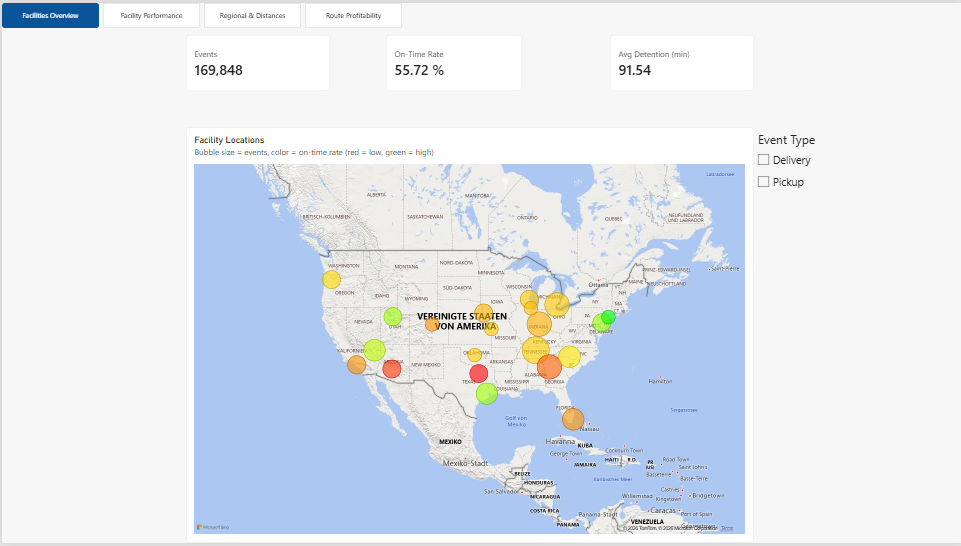
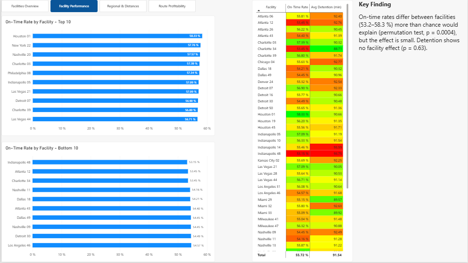
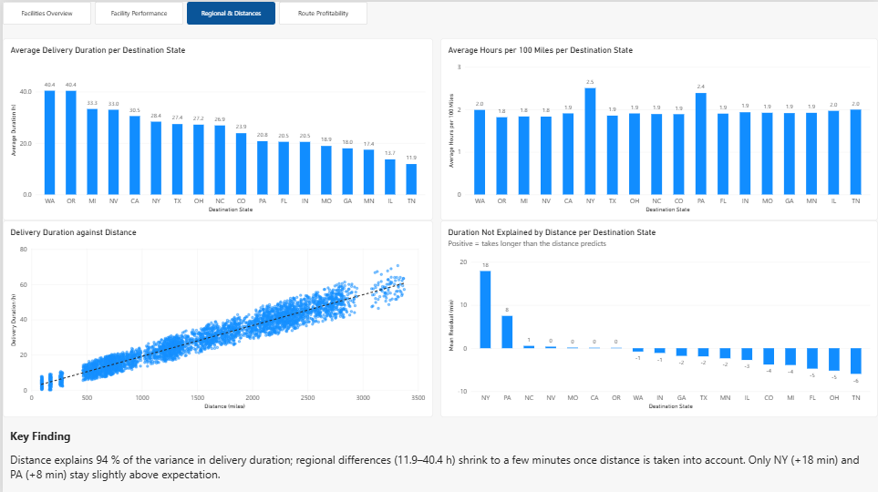
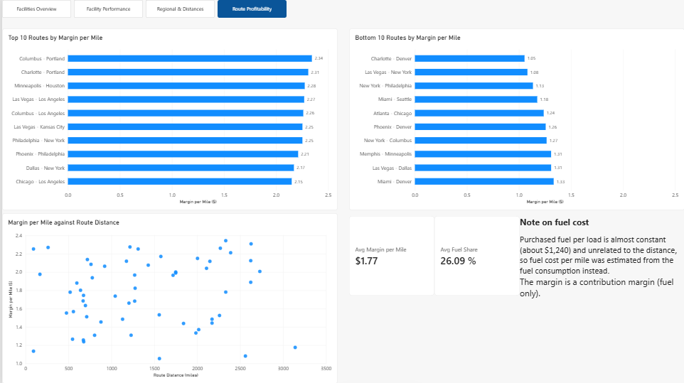

# Dashboard: Regional Analysis

An interactive Power BI dashboard visualizing the facility, region and route profitability
findings from [`04_regional_analysis.ipynb`](../../notebooks/04_regional_analysis.ipynb).

## Data Source

Built on four small, aggregated CSV files in [`data/`](data/), exported from the appendix
of [`04_regional_analysis.ipynb`](../../notebooks/04_regional_analysis.ipynb) (which runs
the ETL pipeline in [`src/delivery_pipeline.py`](../../src/delivery_pipeline.py) with
`include_costs=True`), so the numbers match the notebook:

- **`facility_event_stats.csv`** (100 rows) - events, on-time events and total detention
  per facility and event type, including facility location. Used on pages 1 and 2.
- **`state_dashboard.csv`** (18 rows) - average delivery duration, hours per 100 miles and
  the residual not explained by distance per destination state. Used on page 3.
- **`dist_sample.csv`** (5,000 rows) - random sample of loads (distance, duration, state)
  for the scatter plot. Used on page 3.
- **`route_profit.csv`** (58 rows) - revenue, estimated fuel cost and margin per route.
  Used on page 4.

Each page works on its own table, so no relationships between the tables are needed.
Weighted measures (on-time rate, average detention, hours per 100 miles) are calculated
in Power BI from the sums (DAX), not as averages of averages.

## What's in the Dashboard

**Page 1 - Facilities Overview**
- **KPI cards:** number of events, on-time rate, average detention
- **Map:** facilities by location, sized by number of events and colored by on-time rate
- **Event type slicer:** switches between pickups and deliveries

**Page 2 - Facility Performance**
- **On-time rate per facility** (sorted bar chart) and a table with on-time rate and
  detention, conditionally formatted
- **Key finding:** the spread of on-time rates between facilities (53.2-58.3 %) is larger
  than chance (permutation test, p = 0.0004) but small, while detention shows no facility
  effect (p = 0.63)

**Page 3 - Regional & Distance**
- **Average delivery duration and hours per 100 miles per destination state** (two bar
  charts, same sort order), showing how the regional differences (11.9-40.4 h) shrink
  once distance is taken into account
- **Duration against distance** (scatter plot of a 5,000-load sample)
- **Key finding:** distance explains 94 % of the variance in delivery duration; only NY
  and PA stay slightly above expectation

**Page 4 - Route Profitability**
- **Top and bottom 10 routes by margin per mile** and a scatter plot of margin per mile
  against route distance
- **KPI cards:** average margin per mile and average fuel share of billed revenue
- **Data quality callout:** purchased fuel per load is almost constant (about $1,240) and
  unrelated to the distance, so the fuel cost is estimated from the fuel consumption;
  the margin is a contribution margin (fuel only), not a profit

## Screenshots

*Page 1: KPI cards, facility map and event type slicer.*

Facility performance, regional comparison & profitability

## Opening the Dashboard

Requires [Power BI Desktop](https://powerbi.microsoft.com/desktop/) (free).
Open [`regional_analysis.pbix`](regional_analysis.pbix) directly. It reads from the CSV
files in [`data/`](data/); if Power BI cannot find them, update the file path under
*Transform data > Data source settings*. To regenerate the files, run the appendix of
[`04_regional_analysis.ipynb`](../../notebooks/04_regional_analysis.ipynb) and refresh the
data in Power BI.

## Status

🟢 Finished. Covers the facility, region and route profitability findings from
`04_regional_analysis.ipynb`. Other dashboards live in their own subfolders - see the
[dashboard index](../README.md) for the full list.